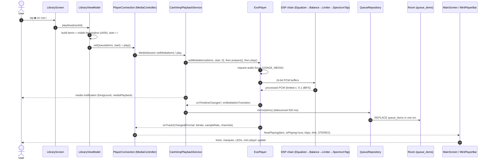
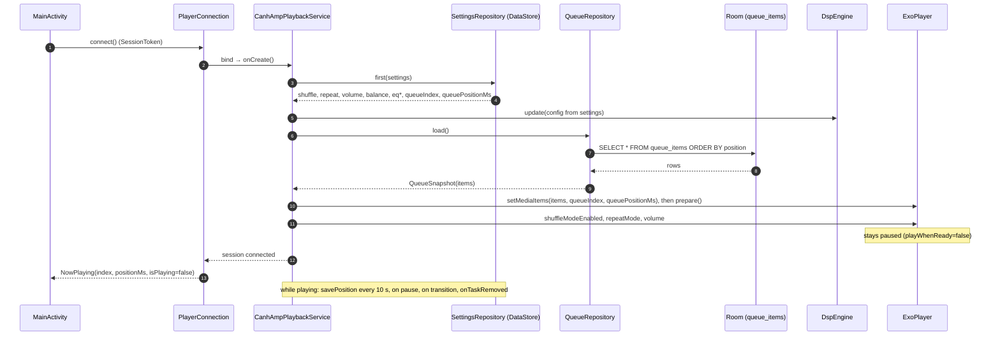
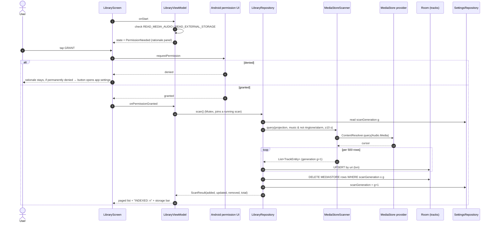
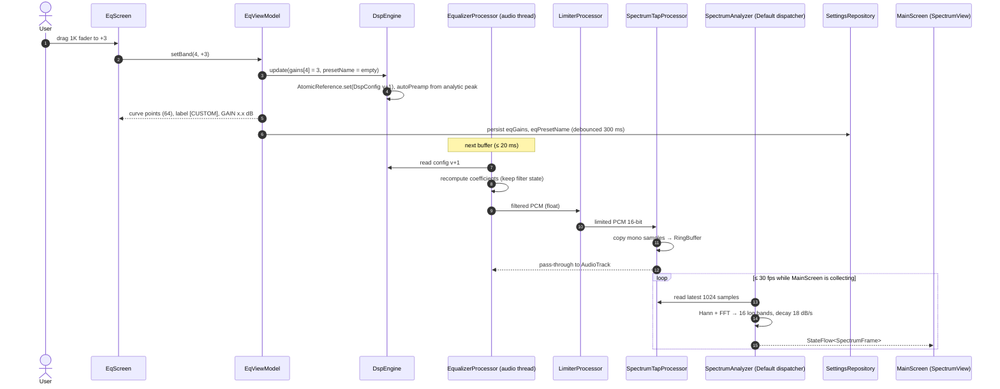
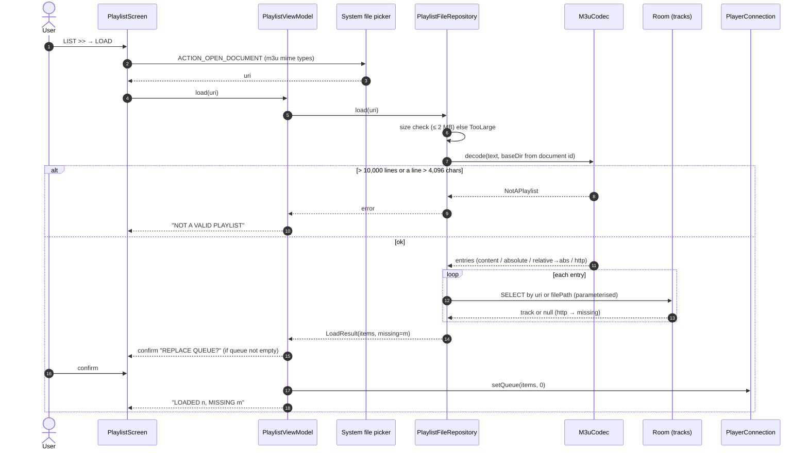
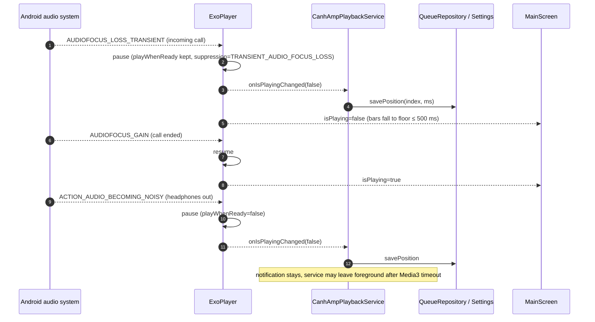
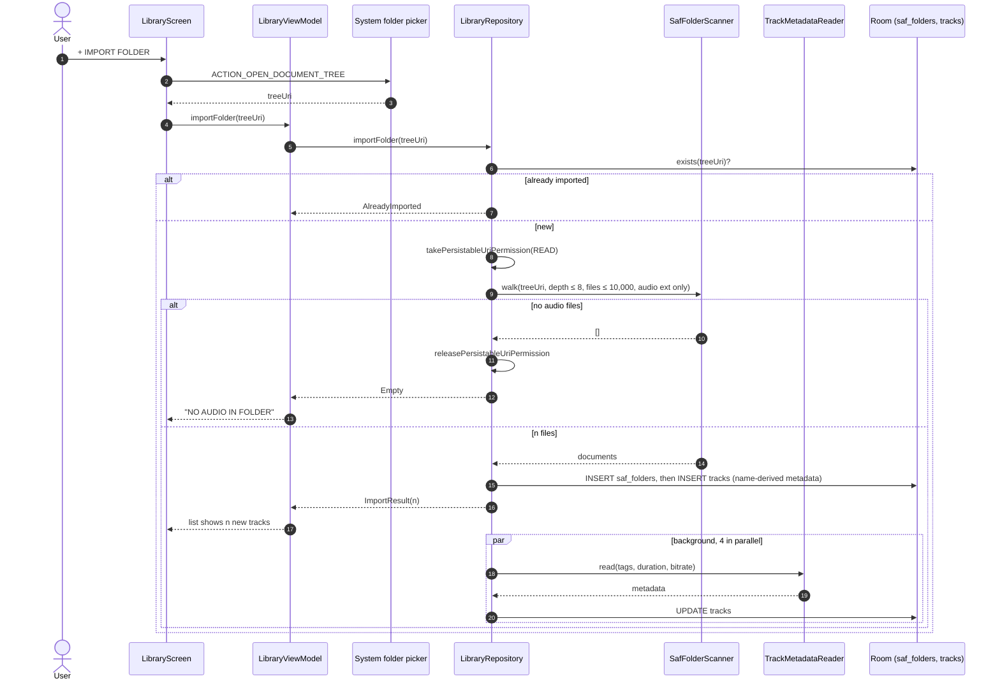

# Sequence Diagrams: Canh Amp, retro MP3 player

- **PRD:** [PRD-retro-player](../prd/PRD-retro-player.md)
- **ADR:** [0001](../adr/0001-audio-dsp-pipeline.md), [0002](../adr/0002-visualizer-pcm-tap.md), [0003](../adr/0003-persistence-room-datastore.md), [0004](../adr/0004-app-id-sdk-and-ci-signing.md)
- **Spec:** [spec-retro-player](../specs/spec-retro-player.md)
- **Status:** Approved design (2026-11-18). Mark "As-built" once implemented.

## 1. Play a track from the Library (main path)

The user taps Play on a library row. The queue is replaced and playback starts with the DSP chain, the notification
and the deck updates (B11, B20, B24).

## 2. App start: restore the queue, position and modes

The service is created when the UI connects. It restores the last session, paused (B31, B56, B57).

## 3. Library scan: permission denied, then granted

The first open of Library has no permission. The user grants it, and the scan fills the index (B1–B6).

## 4. EQ change: audio and visualizer update

The user moves the 1K band. The config is published lock-free, the audio thread picks it up at the next buffer, and the
curve and spectrum reflect it (B43–B52, ADR-0001/0002).

## 5. Load an M3U playlist with missing entries

The user loads a `.m3u` file. Entries resolve only through the library index; unresolved ones are counted (B65, B66, B76).

## 6. Interruptions: phone call and headphones unplugged

Audio focus and becoming-noisy handling come from Media3 defaults configured in `PlayerFactory` (B21).

## 7. Import a folder through SAF (failure: empty folder)

The user imports a folder that MediaStore misses (B10).

